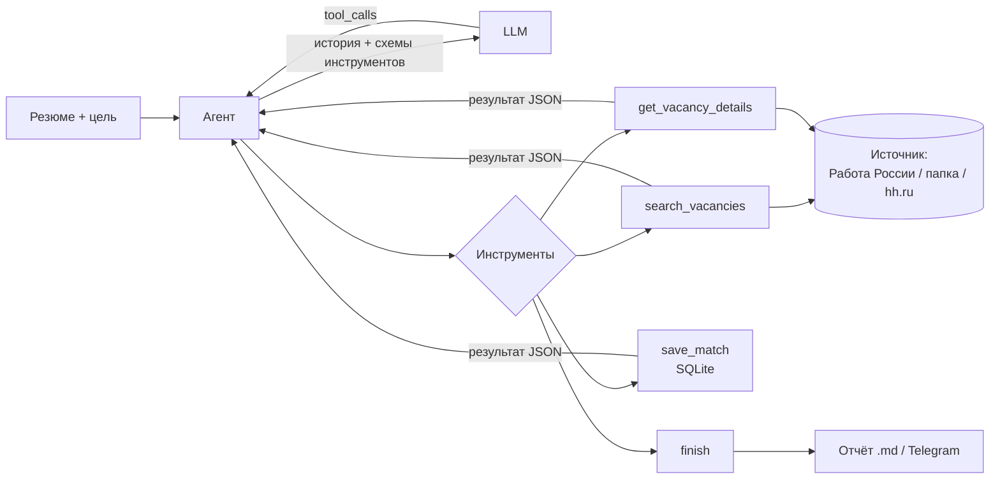

# job-agent — AI-агент для поиска работы


Агент читает резюме и сам ищет подходящие вакансии. Каждую вакансию он оценивает по шкале от 0 до 100 и объясняет оценку. Для лучших вакансий пишет сопроводительные письма. Результат сохраняется в Markdown-отчёт и по желанию отправляется в Telegram.

> **EN:** An LLM agent that searches job boards for vacancies matching a resume, scores each one with reasons, drafts cover letters for the best matches, and keeps history in SQLite. Pluggable vacancy sources (open government API «Работа России», a local folder, hh.ru with an app token). Pure Python, zero dependencies, works with any OpenAI-compatible LLM (Ollama, OpenAI, OpenRouter…) via tool calling.

Реальный запуск (21.10.2026, локальная модель `qwen3.5:4b` через Ollama, источник «Работа России»):

```text
$ python -m job_agent -v run --resume examples/resume_example.md --goal "Junior Python-разработчик или LLM-разработчик"

Источник вакансий: портал «Работа России» (trudvsem.ru). Модель: qwen3.5:4b
…
Шаг 16 → search_vacancies({"text": "Python-разработчик автоматизация", "experience": "noExperience", "schedule": "remote"})
Шаг 17 → finish({"summary": "Найдено 2 релевантные вакансии: …"})

Готово за 17 шаг(ов). Вызовов инструментов: 49.

   60/100  Подумать     Редактор текстов для обучения нейросетей (GigaChat) — Сбербанк России, ПАО
   50/100  Подумать     Python-разработчик (Junior+) — ООО ФИРМА "ИНТЕРСВЯЗЬ"

Итог: … Обе оценены как maybe — у кандидата есть опыт работы с LLM в проекте job-agent,
но не хватает формального опыта разработки API на FastAPI, работы с HTTP/REST и SQL. …
```

## Что умеет

- **Сам решает, что искать.** Модель придумывает несколько поисковых запросов, пробует синонимы, если ничего не нашлось, и отсеивает нерелевантное.
- **Честно оценивает.** Сравнивает требования вакансии с резюме, называет причины и недостающие навыки. Название, зарплату и ссылку агент берёт из источника вакансий, а не из ответа модели, поэтому модель не может их выдумать.
- **Пишет сопроводительные письма.** Для вакансий с решением «откликаться» письмо обязательно: без него инструмент вернёт ошибку.
- **Подключаемые источники вакансий:** «Работа России» (открытый API), папка с сохранёнными вакансиями или hh.ru с токеном.
- **Помнит прошлые запуски.** В SQLite хранится история, и уже оценённые вакансии помечаются флагом `already_evaluated`.
- **Работает с любой LLM** через OpenAI-совместимый API: бесплатно и локально через Ollama или с облачными моделями.
- **Демо-режим:** полный прогон без интернета и ключей.
- **Без зависимостей:** только стандартная библиотека Python (`urllib`, `sqlite3`, `json`).

## Как это работает

Агент построен на **tool calling (function calling)**. Модели передаётся список инструментов в виде JSON-схем. Модель решает, какой инструмент вызвать и с какими аргументами, агент выполняет вызов и возвращает результат модели. Цикл повторяется, пока модель не вызовет `finish`.



| Инструмент | Что делает |
|---|---|
| `search_vacancies` | Поиск вакансий с фильтрами по опыту и графику |
| `get_vacancy_details` | Полное описание вакансии и требования |
| `save_match` | Сохраняет оценку 0–100, решение, причины, недостающие навыки и письмо |
| `finish` | Завершает работу с итоговым выводом |

**Надёжность:**
- ошибки инструментов не роняют агента: модель получает `{"error": "..."}` и может исправить аргументы или попробовать другой запрос;
- лимит шагов (`MAX_STEPS`) защищает от бесконечного цикла;
- запросы к LLM при ошибках 429 и 5xx повторяются с экспоненциальной задержкой;
- аргументы от модели проверяются: диапазон оценки, допустимые решения, существование вакансии.

## Источники вакансий

| Источник | Как включить | Особенности |
|---|---|---|
| **«Работа России»** (trudvsem.ru) | `--source trudvsem` (по умолчанию) | Открытый государственный API, ключ не нужен. IT-вакансий меньше, чем на коммерческих сайтах |
| **Папка с вакансиями** | `--source files --vacancies-dir vacancies` | Каждая вакансия — отдельный `.txt` или `.md` файл, скопированный с любого сайта. Пример: [`examples/vacancy_example.txt`](examples/vacancy_example.txt) |
| **hh.ru** | `--source hh` + `HH_APP_TOKEN` в `.env` | Работает только с токеном приложения с [dev.hh.ru](https://dev.hh.ru) |

**Почему источников несколько.** Сначала агент работал только с публичным API hh.ru. В апреле 2026 года hh.ru закрыл поиск вакансий для запросов без авторизации, и все запросы стали получать `403 forbidden`. Агент при этом не сломался: он получал ошибку, менял запрос и честно завершал работу. Чтобы проект снова был полезным, я выделил общий интерфейс `VacancySource` (методы `search` и `get`) и добавил новые источники. Код агента и инструментов при этом почти не изменился.

## Быстрый старт

Нужен Python 3.10 или новее.

```bash
git clone https://github.com/kaz1pet/job-agent.git
cd job-agent
pip install -e .

python -m job_agent demo     # прогон на вымышленных вакансиях, без интернета и ключей
```

> На Windows команда `job-agent` может быть не видна после установки: папка Scripts не в PATH. Команда `python -m job_agent` работает всегда.

### Настоящий поиск с бесплатной локальной моделью (Ollama)

```bash
# 1. Установите Ollama: https://ollama.com и скачайте модель с поддержкой инструментов
ollama pull qwen3.5:4b

# 2. Настройки
cp .env.example .env          # на Windows: copy .env.example .env

# 3. Поиск на «Работе России»
python -m job_agent -v run --resume examples/resume_example.md --goal "Junior Python / LLM-разработчик"

# или оценка вакансий, которые вы сохранили в папку vacancies/
python -m job_agent -v run --source files --resume examples/resume_example.md --goal "Junior LLM"
```

Отчёт сохраняется в `reports/`. Флаг `--telegram` отправит подборку в Telegram, если в `.env` указаны токен бота и chat_id.

Проверено на `qwen3.5:4b` (видеокарта с 8 ГБ памяти, контекст 32k). Небольшие модели иногда завершают работу раньше времени. Модели покрупнее или облачные справляются стабильнее.

### Облачная модель

В `.env` укажите `LLM_BASE_URL`, `LLM_API_KEY` и `LLM_MODEL` вашего провайдера. Подойдёт любая модель с поддержкой tool calling.

### Docker

```bash
docker build -t job-agent .
docker run --rm job-agent demo
docker run --rm --env-file .env -v "$PWD/data:/app/data" -v "$PWD/reports:/app/reports" \
  -v "$PWD/examples:/app/examples" job-agent run --resume examples/resume_example.md --goal "Junior LLM"
```

> Если Ollama запущена на той же машине, внутри контейнера используйте `LLM_BASE_URL=http://host.docker.internal:11434/v1`.

### Другие команды

```bash
python -m job_agent history --min-score 60   # последние оценённые вакансии
```

## Структура проекта

```text
src/job_agent/
├── agent.py         # агентный цикл и системный промпт
├── tools.py         # инструменты: JSON-схемы + обработчики + валидация
├── llm.py           # клиент OpenAI-совместимого API (tool calling, ретраи)
├── sources.py       # общий интерфейс источника вакансий и выбор источника
├── trudvsem.py      # источник «Работа России» (открытый API)
├── files_source.py  # источник «папка с вакансиями»
├── hh_client.py     # источник hh.ru (нужен токен)
├── models.py        # модели данных, очистка HTML, форматирование зарплат
├── storage.py       # SQLite: запуски, просмотренные вакансии, оценки
├── report.py        # Markdown-отчёт и отправка в Telegram
├── demo.py          # демо-режим: вымышленные вакансии + сценарий вместо LLM
├── config.py        # настройки из .env
├── net.py           # HTTP на urllib
└── cli.py           # командная строка
tests/               # 36 тестов, сеть и LLM подменяются фейками
```

## Тесты

```bash
python -m unittest discover -s tests     # или: pytest
```

Тесты не ходят в интернет: HTTP-транспорт и LLM подменяются фейками (dependency injection). Проверяются цикл агента, восстановление после ошибок инструментов, лимит шагов, ретраи LLM, разбор ответов всех источников (для «Работы России» — на реальном ответе API), SQLite и отчёты. На каждый push тесты запускаются в GitHub Actions.

## Ограничения и планы

- [ ] Откликаться на вакансии агент не умеет, это намеренно: решение принимает человек.
- [ ] Небольшие локальные модели (4–7B) иногда завершают работу раньше времени.
- [ ] RAG по резюме и портфолио, чтобы письма точнее ссылались на проекты.
- [ ] Запуск по расписанию с ежедневной подборкой в Telegram.
- [ ] Веб-интерфейс для просмотра истории.

## Автор

Илья Минаков · [Telegram @ssolarr](https://t.me/ssolarr) · ilyaminakov02@gmail.com

Проект сделан с помощью ИИ-ассистента (Claude). Я ставил задачи, разбирал код и проверял, как агент работает.
